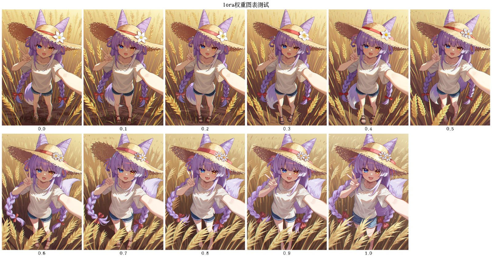
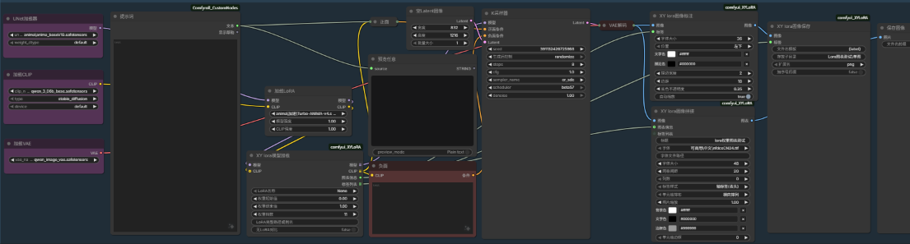
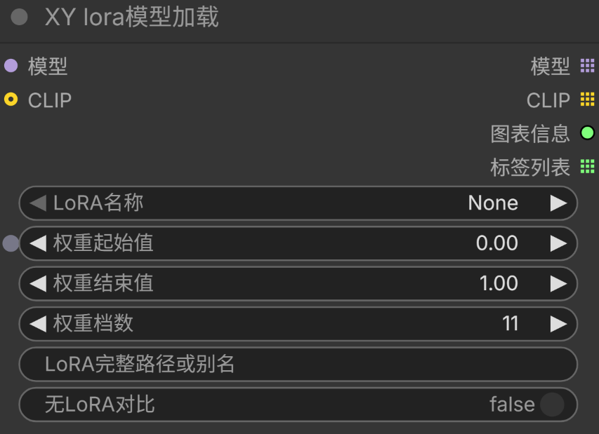
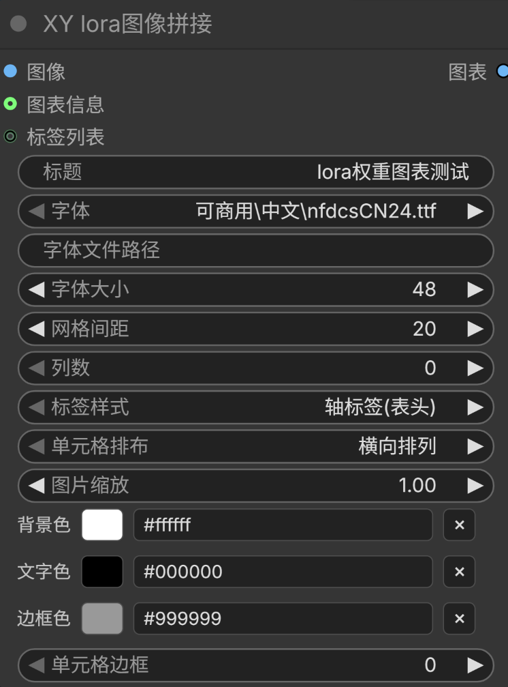
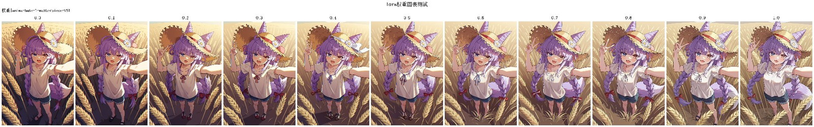
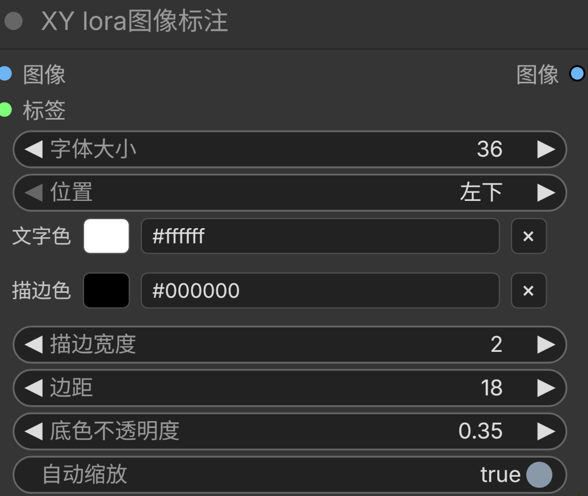
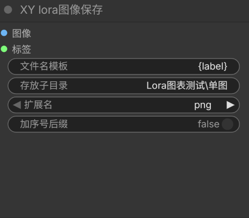
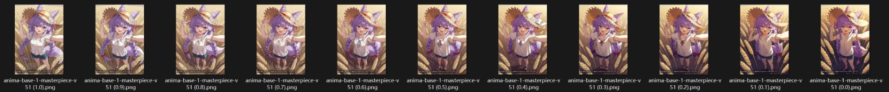
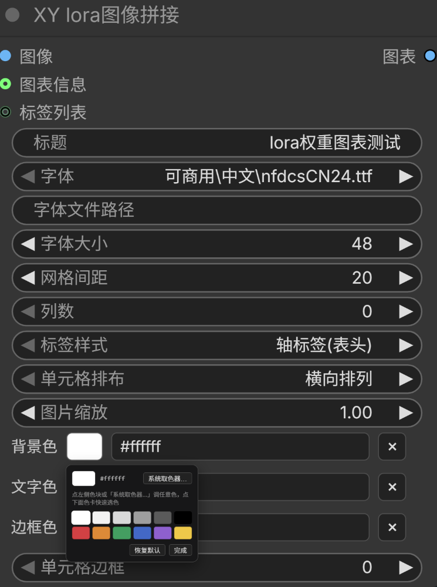

# ComfyUI XY LoRA

用**指定的某一个 LoRA** 做权重 XY 扫描，把结果拼成带标签的图表，并可逐张标注 / 按标签命名保存。

- 输入直接是 **MODEL**，适配 UNET + CLIP 分离加载的模型
- **可强制换行**：11 档权重拼成 6×2，比 1×11 好读得多
- 颜色、字体、边框、标题都能调，出图接近成品图表

<p align="center"><br><sub>同一个 LoRA 跑 11 档权重，6×2 拼图并逐格标注</sub></p>

---

## 目录

- [安装](#安装)
- [四个节点](#四个节点)
- [快速上手](#快速上手)
- [1. XY lora模型加载](#1-xy-lora模型加载)
- [2. XY lora图像拼接](#2-xy-lora图像拼接)
- [3. XY lora图像标注](#3-xy-lora图像标注)
- [4. XY lora图像保存](#4-xy-lora图像保存)
- [颜色控件（色卡）](#颜色控件色卡)
- [字体](#字体)
- [常见问题](#常见问题)
- [示例工作流](#示例工作流)
- [文件结构](#文件结构)
- [截图清单](images/README.md)（要补图时看这里）

---

## 安装

**方式一：git clone（推荐，方便更新）**

```bash
cd ComfyUI/custom_nodes
git clone https://github.com/wanet36/ComfyUI-XY-LoRA.git
```

克隆下来后，插件文件就在 `custom_nodes/ComfyUI-XY-LoRA/` 根目录，ComfyUI 能直接识别。

**方式二：手动复制**

把本仓库的 `__init__.py` / `xy_lora.py` / `xy_grid.py` / `web/` 复制到 `ComfyUI/custom_nodes/` 下任意一个新建文件夹里（文件夹名随意，比如 `ComfyUI-XY-LoRA`）。

装完**重启 ComfyUI**，然后 **Ctrl+F5 强制刷新页面**（前端 JS 有缓存）。

依赖：只有 ComfyUI 自带的 `Pillow` / `numpy` / `torch`，不需要额外安装。

批量文本节点在**独立的子目录** `comfyui_batch_text/` 里，需要的话把那个文件夹单独复制到 `custom_nodes/` 下（不能和本插件放在同一层，ComfyUI 只扫描 `custom_nodes/` 的一级子目录）。细节见 [comfyui_batch_text/README.md](comfyui_batch_text/README.md)。

> 本文的截图统一放在 `images/` 目录下，文件名与正文里的引用一一对应。图片清单、尺寸约定和补图说明见 [images/README.md](images/README.md)。

---

## 四个节点

| class_type | 显示名 | 作用 |
|---|---|---|
| `comfyui_XYLoRA` | **XY lora模型加载** | 按名字选 LoRA，输出 5/11 档权重的模型列表 + 图表信息 |
| `comfyui_XYGridDrawer` | **XY lora图像拼接** | 把多张图拼成一张带标签的图表 |
| `comfyui_ImageBadge` | **XY lora图像标注** | 逐张在图上写标签（LoRA 名 + 权重） |
| `comfyui_SaveWithLabels` | **XY lora图像保存** | 按标签命名保存（文件名里直接带 LoRA 名与权重） |

四个都在菜单分类 `XY LoRA` 下。

> 旧版本用过的 `AnimaXYLoRA` / `AnimaImageBadge` / `AnimaSaveWithLabels` / `AnimaXYGridDrawer` 别名**已删除**。用旧名保存的工作流会提示节点缺失，把类型改成上面的 `comfyui_*` 即可，参数不变。

---

## 快速上手

最小可用连线（从 `UNETLoader + CLIPLoader` 出发）：

```
UNETLoader ─模型─┐
                 ├─► XY lora模型加载 ─模型(列表)─► KSampler ─► VAEDecode ─图像(列表)─┬─► XY lora图像拼接 ─► SaveImage
CLIPLoader ─CLIP─┘        │                                                         └─► XY lora图像标注 ─► XY lora图像保存
                          ├─图表信息─► XY lora图像拼接.图表信息
                          └─标签列表─► XY lora图像拼接 / 图像标注 / 图像保存

CLIPTextEncode(正面) ─► KSampler.正向       CLIPTextEncode(负面) ─► KSampler.负向
EmptyLatentImage ─────► KSampler.latent
```

要点：

1. `XY lora模型加载` 的 `CLIP` 输入**必须接**（LoRA 要同时作用于模型和文本编码器，缺了会直接报错）；
2. 它的 `模型` / `CLIP` 输出是**列表**，接给 KSampler 后 ComfyUI 会逐档执行；
3. `KSampler` 的 negative 接普通负面条件即可；
4. 要拼图就接 `XY lora图像拼接`，想同时出单张带字图就接 `XY lora图像标注`；
5. **`EmptyLatentImage` 别忘接** —— KSampler 少了 latent 输入，XY 扫描一条都不会跑。

实际连线长这样（`images/00-workflow.png`）：

<p align="center"><br><sub>XY lora模型加载 → KSampler → VAEDecode → XY lora图像拼接 → 保存</sub></p>

---

## 1. XY lora模型加载

`comfyui_XYLoRA` · 分类 `XY LoRA`

按名字指定一个 LoRA，从「权重起始值」到「权重结束值」均分「权重档数」档，逐档输出模型与 CLIP。

<p align="center"><br><sub>XY lora模型加载：模型 / CLIP 两个输入，权重三件套</sub></p>

### 输入

| 名称 | 类型 | 默认 | 说明 |
|---|---|---|---|
| `模型` | MODEL | — | 必接，`UNETLoader` 的输出 |
| `LoRA名称` | 下拉 | — | 列出 `models/loras` 下所有文件，可搜索；也可直接键入文件名（递归匹配唯一项） |
| `权重起始值` | FLOAT | 0.2 | 第一档权重，范围 -10 ~ 10 |
| `权重结束值` | FLOAT | 1.0 | 最后一档权重 |
| `权重档数` | INT | 5 | 1 ~ 50；档数 1 时只跑 `权重起始值` 一档 |
| `CLIP` | CLIP | — | **必接**，`CLIPLoader` 的输出 |
| `LoRA完整路径或别名` | STRING | 空 | 非空时优先于下拉框：可填绝对路径或列表之外的写法 |
| `无LoRA对比` | BOOLEAN | 关 | 额外跑一张完全不加 LoRA 的图作为基线，放在第一档位置 |

**权重计算**：`step = (结束值 - 起始值) / (档数 - 1)`，各档四舍五入到 3 位小数。

例：0.2 → 1.0，11 档 → `0.2, 0.28, 0.36, 0.44, 0.52, 0.6, 0.68, 0.76, 0.84, 0.92, 1.0`

**LoRA 名称的三种写法**：

1. 相对路径（推荐）：`anima\美学\anima-base-1-masterpiece-v51.safetensors`
2. 仅文件名：`anima-base-1-masterpiece-v51.safetensors`（在 loras 目录里递归找唯一匹配，命中多个会报错并列出候选）
3. 绝对路径：`D:\...\xxx.safetensors`

下拉框里直接敲字就能筛（按子串过滤），候选来自 `models/loras` 下的全部文件。

### 输出

| 名称 | 类型 | 说明 |
|---|---|---|
| `模型` | MODEL 列表 | 每档一个，逐条执行 |
| `CLIP` | CLIP 列表 | 与模型一一对应 |
| `图表信息` | `XY_GRID_INFO` | 布局字典，接拼接节点的「图表信息」 |
| `标签列表` | STRING 列表 | 每档的标签，格式固定为 `LoRA文件名 (权重)`，如 `anima-base-1-masterpiece-v51 (0.5)` |

`图表信息` 的结构（拼接节点按它排版）：

```python
{
    "x_labels": ["0.2", "0.28", ..., "1.0"],   # 列标签 = 各档权重
    "y_labels": [""],                          # 只有一行
    "x_title": "权重 | anima-base-1-masterpiece-v51",
    "y_title": "",
    "count_x": 11,                             # 列数 = 实际图片数
    "count_y": 1,
    "cell_image_counts": [1] * 11,
    "total_images": 11,
}
```

所以默认（列数 = 0）时，拼接节点会排成 **1×11 一条长条**。想排成 6×2，把拼接节点的「列数」填 6。

---

## 2. XY lora图像拼接

`comfyui_XYGridDrawer` · 分类 `XY LoRA`

把 XY 扫描产出的多张图拼成一张带标签的图表。几个特点：

- **能强制换行**：「列数」填 N 就按 N 列排，超出自动换行，图再多也不用挤成一条长条
- **逐格标注**：每张图下方写自己的标签，配合换行最好读
- **字体逐级回退**：插件自带字体 → 本插件 `fonts/` → 系统字体，缺字体只降级不报错
- **单元格边框 / 总标题 / 图片缩放 / 自定义颜色**：出图更接近成品图表

<p align="center"><br><sub>XY lora图像拼接：标题在最上方，背景/文字/边框三行色块带 × 清空，最后一行是单元格边框</sub></p>

### 输入

**必接**

| 名称 | 类型 | 默认 | 说明 |
|---|---|---|---|
| `图像` | IMAGE | — | 接 `VAEDecode`。上游传列表时本节点一次性全部收下 |
| `标题` | STRING | 空 | 画在图表正上方的总标题，留空不画 |
| `字体` | 下拉 | 第一个可用 | 优先列出 `custom_nodes` 下插件自带的字体，其次本插件 `fonts/`，再次系统字体 |
| `字体文件路径` | STRING | 空 | 填绝对路径可覆盖上面的下拉；留空用下拉里的字体 |
| `字体大小` | INT | 48 | 8 ~ 400。总标题会按 1.25 倍放大 |
| `网格间距` | INT | 20 | 图与图、图与标签之间的留白，单位像素 |
| `列数` | INT | 0 | **0 = 按图表信息排布**（排成 1×N 长条）；填 N = 强制每行 N 列，超出换行。图多时建议 5~8 |
| `标签样式` | 下拉 | 轴标签(表头) | `轴标签(表头)` / `逐格标注` / `不显示` |

**可选**

| 名称 | 类型 | 默认 | 说明 |
|---|---|---|---|
| `图表信息` | * | — | 接 `XY lora模型加载` 的「图表信息」。不接也能用：列数会退回 `√总数` 的近似方形 |
| `标签列表` | STRING | — | 接「标签列表」；逐格标注时优先用它 |
| `单元格排布` | 下拉 | 横向排列 | 一个格子里有多张图时的排列方向（横向 / 竖向） |
| `图片缩放` | FLOAT | 1.0 | 0.1 ~ 4.0，拼图前先缩放每张单图，用来压总尺寸 |
| `自定义背景色` | STRING | 空 | 带色卡。留空 = 白色 |
| `自定义文字色` | STRING | 空 | 带色卡。留空 = 黑色 |
| `边框颜色` | STRING | `#999999` | 带色卡。清空 = 灰色 |
| `单元格边框` | INT | 0 | 0 = 不画边框，最大 20 |

### 三种标签样式

- **轴标签(表头)**：列标签画在顶部、行标签画在左侧，左上角画 `Y \ X` 形式的轴名。
  只有一行且没有 Y 轴标签时，轴名会挪到列标签上方当整条表头的标题，避免左侧留一大片空白。
- **逐格标注**：每张图下方写自己的标签。配合「列数」换行使用，最常用的组合是 `列数 = 6` + 逐格标注。
- **不显示**：纯拼图，不画任何文字。

> **自动降级**：选了「轴标签」但图表信息的列数/行数标签和实际排布对不上时（比如填了 `列数 = 6`，而图表信息是 1 行 11 列），会自动改用逐格标注，不会画出错位的表头。

### 输出

| 名称 | 类型 | 说明 |
|---|---|---|
| `图表` | IMAGE | 拼好的单张图，接 `SaveImage` / `PreviewImage` |

收不到任何图像时，返回一张 64×64 的黑色占位图并在日志里告警，不会中断队列。

### 出图示例

**列数 = 0，轴标签(表头)** —— 排成一条长条，权重值排在顶部：

<p align="center"><br><sub>列数 0 + 轴标签(表头)：排成 1×11 长条，各档权重作列标签，左上角是「权重 | LoRA名」</sub></p>

**列数 = 6，逐格标注** —— 同一批图的换行版，每张图下方带自己的标签：

<p align="center"><br><sub>列数 6 + 逐格标注：同一批图换成 6×2，每格下方写自己的标签</sub></p>

### 已知限制

- **「单元格边框」必须是最后一个控件**：前端 1.55 里末位若是 DOM 色卡，覆盖层会盖住节点右下角的缩放手柄，节点就再也拖不动大小了。改代码时别调换顺序。
- 节点内部用 `INPUT_IS_LIST = True`，所以它的每个标量输入在 Python 里都是单元素列表，已统一取第一个值。

---

## 3. XY lora图像标注

`comfyui_ImageBadge` · 分类 `XY LoRA`

逐张在图上写文字（LoRA 名 / 权重），用于出单张带字图，不必拼成大图。

<p align="center"><br><sub>XY lora图像标注：文字色 / 描边色带色卡</sub></p>

### 输入

| 名称 | 类型 | 默认 | 说明 |
|---|---|---|---|
| `图像` | IMAGE | — | 必接 |
| `标签` | STRING | — | 必接（仅连线）。接 `XY lora模型加载` 的「标签列表」 |
| `字体大小` | INT | 36 | 8 ~ 300 |
| `位置` | 下拉 | 左下 | 左下 / 左上 / 右下 / 右上 / 居中 |
| `文字颜色` | STRING | `#FFFFFF` | 带色卡。清空 = 白 |
| `描边颜色` | STRING | `#000000` | 带色卡。清空 = 黑（`描边宽度 = 0` 时不画） |
| `描边宽度` | INT | 2 | 0 ~ 20 |
| `边距` | INT | 18 | 文字距图片边缘的像素 |
| `底色不透明度` | FLOAT | 0.35 | 文字后面垫一条黑色半透明底，0 = 不垫 |
| `自动缩放` | BOOLEAN | 开 | 文字超出可用宽度时自动缩字号（最小 8） |

### 标签分配规则

- 标签数与图数相等：一一对应；
- 标签数少于图数：多出来的图**沿用最后一个标签**；
- 只给一个标签：等于给整批图盖同一个水印。

标注效果（左下角、白字黑描边、黑色半透明底）：

<p align="center"><br><sub>单张图左下角写 LoRA名 (权重)，白字黑描边 + 半透明底条</sub></p>

### 输出

| 名称 | 类型 | 说明 |
|---|---|---|
| `图像` | IMAGE | 标注后的图（批量） |

字体固定走插件字体目录回退链（`nfdcsCN24.ttf → nfdcsCN16.ttf → 系统字体`），本节点不提供字体选择。

---

## 4. XY lora图像保存

`comfyui_SaveWithLabels` · 分类 `XY LoRA`

自带 `SaveImage` 每批只能用一个 `filename_prefix`，没法逐张命名。本节点把每张图的标签清洗后作为文件名主体：

```
anima-base-1-masterpiece-v51_0.5.png
anima-base-1-masterpiece-v51_0.75.png
```

<p align="center"><br><sub>XY lora图像保存：模板 + 子目录 + 扩展名</sub></p>

### 输入

| 名称 | 类型 | 默认 | 说明 |
|---|---|---|---|
| `图像` | IMAGE | — | 必接 |
| `标签` | STRING | — | 必接（仅连线），接「标签列表」 |
| `文件名模板` | STRING | `{label}` | 占位符：`{label}` = 标签原文，`{index}` = 序号。例：`{index}_{label}` |
| `存放子目录` | STRING | `anima_xy/labeled` | 相对 `output/` 的子目录 |
| `扩展名` | 下拉 | png | png / jpg / webp（jpg、webp 固定质量 95） |
| `加序号后缀` | BOOLEAN | 关 | 见下 |

### 两种命名方式

- **关**（默认）：`标签.png`。重名时自动追加 `_2`、`_3`…，文件名干净。
- **开**：`标签_00001_.png`，与自带 `SaveImage` 的计数器风格一致。

跑完之后 `output/` 里是这样（`images/10-save-files.png`）：

<p align="center"><br><sub>文件名直接就是 LoRA 名 + 权重，不用再回头查是哪一档</sub></p>

### 其它行为

- PNG 会写入 `prompt` / `workflow` 元数据，拖回 ComfyUI 能还原工作流；
- jpg / webp **不写**元数据；
- 文件名清洗：去掉 `.safetensors` 后缀、`\` 只保留最后一段、非法字符 `< > : " | ? * #` 和换行统一换成 `_`、压缩空白、最长 120 字符；结果为空时回落 `image`；
- 标签少于图像时，超出的图沿用最后一个标签。

---

## 颜色控件（色卡）

`自定义背景色` / `自定义文字色` / `边框颜色` / `文字颜色` / `描边颜色` 这几项虽然类型是 `STRING`，但前端会把它们换成一行**色块 + hex 输入框 + 清空按钮**：

<p align="center"><br><sub>点色块弹出取色面板：系统取色器按钮 + 12 色色卡 + 恢复默认 / 完成</sub></p>

- 点色块 → 弹出取色面板：系统取色器（任意色）+ 12 色色卡 + `恢复默认` / `完成`；
- 也可以直接在 hex 框里手填 `#RRGGBB` 或 3 位简写 `#RGB`；
- 留空 = 未设置，走各控件的默认色。

色卡（12 色）：

| 白 | 浅灰 | 灰 | 中灰 | 深灰 | 黑 |
|---|---|---|---|---|---|
| `#FFFFFF` | `#F2F2F2` | `#D9D9D9` | `#9E9E9E` | `#5A5A5A` | `#000000` |

| 红 | 橙 | 绿 | 蓝 | 紫 | 黄 |
|---|---|---|---|---|---|
| `#D64040` | `#E08A2E` | `#3C9E60` | `#3A68C8` | `#8E5FD0` | `#F0C840` |

拼接节点的颜色输入还额外接受中文色名：`白色` `黑色` `灰色` `浅灰` `深灰` `红色` `绿色` `蓝色` `黄色`。

**兼容旧工作流**：控件顺序调整过两次，前端会按 `widgets_values` 的项数（15 项 / 13 项）识别旧布局并按名字重新对齐，不会把值串到别的控件上。同时会把旧版本留下的历史自定义标题清掉，让标题自动回落到当前显示名。

---

## 字体

拼接节点的字体下拉来自三处，按优先级排列：

1. `custom_nodes` 下各插件自带的字体目录（`**/Font/**`，优先展示 6 个推荐中文字体）
2. 本插件 `fonts/**`（自己往里丢 ttf/otf/ttc 即可，显示前缀 `本地\`）
3. `C:\Windows\Fonts` 里的 `msyh.ttc` / `msyhbd.ttc` / `simhei.ttf` / `simsun.ttc` / `segoeui.ttf` / `arial.ttf`（显示前缀 `系统\`）

字体表带缓存，新丢进去的字体需要重启 ComfyUI 才会出现。找不到任何字体时回退 Pillow 默认字体（中文会变方块）。

---

## 常见问题

**菜单里找不到节点 / 老工作流节点变红**
重启 ComfyUI。若是老工作流，检查 class_type 是否是 `Anima*` 旧名 —— 旧别名已删除，改成 `comfyui_*` 即可。

**色卡不显示、或节点右下角拖不动大小**
按 Ctrl+F5 强制刷新，确保加载了新 JS。另外不要把色卡控件放到输入列表最后一位（原因见拼接节点的「已知限制」）。

**跑了 0 张图**
`KSampler` 的 `latent` 没接（缺 `EmptyLatentImage`）；或 `XY lora模型加载` 的 `CLIP` 没接；或 `权重档数` 为 1 且只输出一档。看控制台报错最准。

**报错「找不到 LoRA 'xxx'」**
报错信息末尾会列出当前可用的前几个 LoRA。改成 `loras` 目录下的相对路径最稳。

**报错「匹配到多个文件」**
只给了文件名但目录里有重名，改填相对路径。

**拼出来是 1 条长条**
「列数」还是 0。填 6~8 换行。

**拼出来没有标签**
`标签样式` 选了「不显示」；或「轴标签」模式下降级成了逐格标注但没接「标签列表」（此时会退回用图表信息里的 `x_labels`）。

**中文变方块**
选的字体不含中文。从下拉里挑 `可商用\中文\**` 的字体，或在 `字体文件路径` 填一个中文字体的绝对路径。

**改完 Python 代码不生效**
ComfyUI 需要重启（Node 定义在启动时注册）。改 `web/*.js` 只需 Ctrl+F5。

---

## 文件结构

```
ComfyUI-XY-LoRA/
├── __init__.py              汇总注册（4 个节点）
├── xy_lora.py               comfyui_XYLoRA / comfyui_ImageBadge / comfyui_SaveWithLabels
├── xy_grid.py               comfyui_XYGridDrawer
├── web/
│   ├── anima_color_widget.js        色卡 + 取色面板、旧布局对齐、旧标题还原
│   └── anima_xy_lora_autocomplete.js  「LoRA名称」输入框的自动补全
├── fonts/                   （可选，自己建）放字体，显示为「本地\xxx.ttf」
├── images/                  README 用到的截图
├── workflows/
│   └── lora权重测试.json      示例工作流（4 个节点 + KSampler 全接好）
└── comfyui_batch_text/      可选的独立插件：批量读 txt → 提示词 / 条件
    ├── __init__.py
    ├── batch_text.py
    └── README.md
```

两个 JS 会被 ComfyUI 自动加载（`WEB_DIRECTORY = "./web"`），不需要手动引入。

---

## 示例工作流

`workflows/lora权重测试.json` 是上面所有截图的来源，可直接拖进 ComfyUI：

- `UNETLoader` + `CLIPLoader` → `XY lora模型加载`（11 档权重 0.0~1.0）
- `KSampler` + `EmptyLatentImage`，latent 已连好，导入即可跑
- 同时接了 `XY lora图像拼接`（出大图）和 `XY lora图像标注` → `XY lora图像保存`（出单张带字图）
- 打开后如果 LoRA 路径报错，把「LoRA名称」换成你自己模型库里的那条即可

---

## 兼容性

- ComfyUI 前端 1.55 验证通过（Classic 画布与 Nodes 2.0 面板都可用）；
- 所需前端能力：`node.addDOMWidget` + `options.getValue/setValue` + `getMinHeight`（1.55 及以上）；
- 后端只依赖 ComfyUI 自身 API：`comfy.sd.load_lora_for_models`、`folder_paths.get_filename_list("loras")`、`folder_paths.get_save_image_path`。
